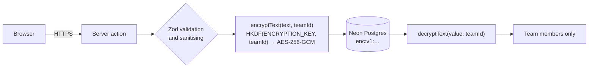

<div align="center">

<picture>
  <source media="(prefers-color-scheme: dark)" srcset=".github/assets/banner-dark.svg">
  
</picture>

**A private idea vault and execution board for friends, classes and small squads.**<br>
Capture ideas, agree on the good ones, turn them into projects, and ship them together.

[**Use it free at blueprint.raqameen.com**](https://blueprint.raqameen.com) · [Self-host it](#self-hosting) · [Security](#security-and-privacy) · [License](#license)

[](https://nextjs.org)
[](https://react.dev)
[](https://www.typescriptlang.org)
[](https://clerk.com)
[](https://neon.tech)
[](https://prisma.io)
[](#field-encryption)
[](./LICENSE)

</div>

---

## Contents

- [Why Blueprint](#why-blueprint)
- [Features](#features)
- [Using Blueprint](#using-blueprint)
- [Roles and permissions](#roles-and-permissions)
- [Security and privacy](#security-and-privacy)
- [Tech stack](#tech-stack)
- [Self-hosting](#self-hosting)
- [Deploy to Vercel](#deploy-to-vercel)
- [Administration](#administration)
- [Project structure](#project-structure)
- [Contributing](#contributing)
- [Support](#support)
- [License](#license)

## Why Blueprint

Big project tools are built for org charts. A few friends with a side project need none of it: no sprints, no story points, no seat licences, no workflow editor. Every minute spent configuring a tool is a minute the idea goes cold.

A small team needs three things, and Blueprint is built around them:

1. **A place to put ideas the moment they land.** Type it, tag it, done.
2. **A way to agree which ones are worth doing.** Sparks are one-click co-signs, so the best ideas rise without a meeting.
3. **A quiet signal that someone is on it.** Press *Start working* and your name lights up for the whole team.

When something ships, it stays on the record with your `@username` on it.

## Features

### Ideas and projects

- **Idea vault.** One shared list per team. Tag ideas `#feature`, `#bug`, `#experiment` or `#random`, spark the ones you like, and sort by most sparked or newest.
- **Promote to a project.** Break an idea into up to twelve tasks at once, each with its people and a priority. Or start a project from scratch.
- **Project pages.** Each project has its own page: description, progress, who is on it and what they're working on, and a board with only its tasks.
- **Archive and restore.** Archive ideas or projects to tidy up, and bring them back any time from team settings.

### Getting work done

- **Execution board.** Kanban (`Backlog → Ready → In progress → Done`) or a compact list, filtered to *My tasks*, *All tasks*, unassigned, or any teammate.
- **Rich tasks.** Every task has a title, a description, notes, a priority and a project, plus a checklist of **subtasks**.
- **Several people per task.** Assign one person or many to a task, and give each subtask its own people.
- **Private tasks.** When creating a task, choose **Everyone** or **Assignees only**. Private tasks are visible only to their assignees, their creator, the owner, co-owners and roles allowed to see them, and are never even sent to anyone else's browser.
- **Live focus.** *Start working* shows the team what you're on right now, with a running timer. Several people can be in focus on the same task. It refreshes every 15 seconds while the tab is open.
- **Shipped.** A timeline of everything finished and who finished it, with weekly and all-time counts.

### Teams

- **Usernames.** Everyone picks a unique `@username` when they join, with a live availability check.
- **Unlimited teams.** Create as many as you like and invite people by searching their `@username`. Invites arrive in a bell with one-click accept.
- **Team roles.** Owner, co-owners and plain members, plus **custom roles** you design permission by permission. See [Team roles](#team-roles).
- **Team settings.** Rename the team, manage members and roles, hand over ownership, manage projects and the archive, clear shipped tasks, leave, or delete the team.
- **Careful deletes.** Small deletes (a task, an idea) need a tick confirming there's no undo. Big ones (a project, a team, bulk clean-ups) need the exact name typed back.

### Account

- **Account window.** Appearance (dark, light or system theme) and Usage live inside the standard account window alongside your profile and security settings.
- **Free and unlimited.** No caps on teams, ideas, projects or tasks. The Usage page shows what you've made.
- **Support.** A *Contact support* button in the dashboard and user menu, plus Privacy Policy and Terms pages.

### Platform

- **Site staff roles.** Support, Moderator and Admin roles with an admin panel for accounts, teams and the audit log. See [Administration](#administration).
- **Encrypted content.** Idea and task text is encrypted with a key unique to each team before it's stored. See [Field encryption](#field-encryption).
- **Interactive landing page.** The hero and the product tour are working replicas of the app, built in React and Framer Motion. No screenshots.

## Using Blueprint

1. **Sign up** with Google or GitHub, then choose your `@username` and colour.
2. **Create a team** and invite people with **Invite teammates**, searching by `@username`.
3. **Capture ideas** in the **Idea vault**. Add tags, and spark the ones you believe in.
4. **Promote** a good idea into a project with tasks, or start a project from **Execution → New project**.
5. **Plan the work.** Add tasks with the quick-add bar: pick who's on it and whether everyone or only assignees can see it. Open a task to write its description and notes and break it into subtasks.
6. **Work the board.** Assignees press **Start working** so the team knows, tick subtasks as they go, and press **Mark done** when it ships.
7. **Look back** in **Shipped** to see everything the team finished and who finished it.
8. **Set up roles** in **Settings → Roles**: create custom roles and give them to members from the member list.

## Roles and permissions

Blueprint has two kinds of role. **Team roles** apply inside one team. **Site roles** apply to the whole Blueprint instance, for running and moderating it.

### Team roles

| Role | What they can do |
| --- | --- |
| **Owner** | Everything, including deleting the team and its projects, choosing co-owners and transferring ownership. One per team. |
| **Co-owner** | Everything except deleting the team or projects, and choosing co-owners. Creates and manages custom roles. |
| **Member** (default) | Capture and spark ideas, manage their own ideas, and work on and finish tasks and subtasks assigned to them. They can't create or edit tasks. |
| **Custom role** | Exactly the permissions the owner or a co-owner picks for it (replaces the member defaults). |

Permissions a custom role can grant:

| Group | Permission | Allows |
| --- | --- | --- |
| Ideas | Capture ideas | Add ideas to the vault |
| | Manage all ideas | Edit, archive and delete anyone's ideas |
| Projects | Create projects | Start projects and promote ideas |
| | Edit projects | Change any project's name and description |
| | Archive projects | Archive and restore projects |
| Tasks | Create tasks | Add tasks and subtasks, choose assignees and visibility, and edit tasks they created |
| | Edit any task | Change details, assignees, priority, visibility and subtasks |
| | Move any task | Start, move and finish tasks they aren't assigned to |
| | Delete tasks | Permanently delete tasks |
| | See private tasks | See tasks that are visible to assignees only |
| People | Invite people | Invite people by username |
| | Manage members | Remove members and give them roles, but only roles with permissions they have themselves |
| Team | Edit team details | Change the team name and description |
| | Clean up | Clear shipped tasks and empty the archive |

Deleting projects and the team always stays with the owner. Every rule is enforced on the server in each action (`lib/team-permissions.ts`, `lib/team-access.ts`); the interface only hides what you can't use.

### Site roles

| Role | Can do |
| --- | --- |
| `USER` | Everyone. No admin access. |
| `SUPPORT` | Read-only admin panel: look up accounts, teams and the audit log. |
| `MODERATOR` | Support, plus suspend and unsuspend accounts and sign them out everywhere. |
| `ADMIN` | Everything: change site roles, delete accounts, delete teams. |

Staff can only act on accounts ranked below them (admins can act on anyone), never on themselves, and the last admin can't be removed. **No site role can read the text of ideas, projects or tasks.** The admin panel shows accounts, memberships and counts only.

## Security and privacy

### Field encryption

Idea and task text is encrypted in the application before it's written to Postgres, so it never sits in the database, its backups or Prisma Studio as plain text.

| Encrypted (AES-256-GCM) | Stays plain, so Postgres can index, sort and filter |
| --- | --- |
| Idea and project titles and descriptions | Tags, sparks, statuses, priorities, visibility |
| Task titles, descriptions and notes; subtask titles | Team, author and assignee ids, roles, timestamps |

- **One key per team.** Each team's key is derived with HKDF-SHA256 from the master `ENCRYPTION_KEY` and the team id. A key for one team can't decrypt another team's rows.
- **Fresh IV on every write.** Values are stored as `enc:v1:<iv>:<authTag>:<ciphertext>` with a random 12-byte IV, so identical text never looks the same twice. The GCM auth tag rejects any altered or moved ciphertext.
- **Validate first, then encrypt.** Zod validation, sanitising and tag parsing run on the plaintext inside each server action, before encryption.
- **Fails closed in production.** The app refuses to start, and Vercel builds fail, without a valid `ENCRYPTION_KEY`. In local development it falls back to plaintext with a warning.
- **Backwards compatible.** Rows written before encryption are read as-is. Run `npm run db:encrypt -- --apply` to encrypt them in place.



> [!IMPORTANT]
> Back up `ENCRYPTION_KEY` somewhere safe and never change it once data exists. If it's lost or changed, encrypted text can't be read again.

### Security architecture

| Layer | What it does | Where |
| --- | --- | --- |
| **Per-team AES-256-GCM field encryption** | Idea and task contents are encrypted with per-team HKDF-derived keys before they reach Postgres, so raw ideas are never stored in plaintext in the database or the audit log. | `lib/crypto.ts`, `instrumentation.ts` |
| **Zero-trust team isolation** | Every team-scoped action resolves the session to a Prisma user, re-proves membership and reloads the caller's team permissions from Postgres. URL slugs and client ids are never trusted. | `lib/team-access.ts`, `app/actions/*` |
| **Team permissions and private tasks** | Owner, co-owner, member and custom-role permissions are checked on every action. Private tasks are filtered in the database query, so they never reach people who can't see them, and acting on one behaves exactly as if it didn't exist. | `lib/team-permissions.ts`, `lib/task-visibility.ts` |
| **Anti-IDOR** | Every update and delete is scoped with `{ id, teamId: verifiedTeamId }`. Assignees must belong to that exact team. | `app/actions/*` |
| **Site roles and suspensions** | Staff permissions are re-read from the database on every admin action. Suspended accounts are blocked from every page, action and API route, and banned in Clerk too. Non-staff get a 404 for `/admin`. | `lib/site-roles.ts`, `app/actions/admin.ts` |
| **Rate limiting** | Sliding windows per IP and per user: 100 req/min globally, 30/min for search and username checks, 20/min for writes. Returns `429` with `Retry-After`. In memory by default; shared through Upstash or Vercel KV when configured. | `lib/rate-limit.ts`, `proxy.ts` |
| **CSRF and origin checks** | Every server action verifies `Origin` against `Host`. Read endpoints reject cross-site `Sec-Fetch-Site`. | `lib/action.ts`, `lib/api.ts` |
| **Strict validation** | Zod `.strict()` schemas on every input. Control characters, bidi overrides and HTML are stripped. Parameterised queries only. 64 KB action body limit. | `lib/validations.ts` |
| **Hardened headers** | Per-request nonce CSP with `strict-dynamic`, `object-src 'none'` and `frame-ancestors 'none'`; HSTS preload; `X-Frame-Options: DENY`; `nosniff`; strict referrer and permissions policies. | `proxy.ts`, `next.config.ts` |
| **Typed confirmations** | Destructive actions check the typed project, team or username on the server, not only in the UI. | `app/actions/*` |
| **Safe errors** | Errors are logged server-side and mapped to generic messages. Stack traces and database codes never reach the browser. | `lib/action.ts` |
| **Audit log** | Team, membership and staff actions are recorded with the actor and IP. Entries hold ids and action names, never content. | `lib/action.ts`, `/admin/audit` |

Found a vulnerability? Please email **support@raqameen.com** instead of opening a public issue.

## Tech stack

| | |
| --- | --- |
| **Framework** | Next.js 16 (App Router, server actions, Turbopack), React 19, TypeScript 5 |
| **Auth** | Clerk (Google and GitHub sign-in), lazy user sync with no webhooks |
| **Database** | Neon serverless Postgres with Prisma 6 in driver-adapter mode (`engineType = "client"`, no native engine) |
| **UI** | Tailwind CSS 4, Framer Motion, light and dark themes |
| **Validation** | Zod 4 |
| **Crypto** | Node `crypto`: AES-256-GCM with HKDF-SHA256 key derivation, no extra dependencies |
| **Hosting** | Vercel (`iad1`, next to Neon `us-east-1`), optional Upstash Redis for shared rate limits |

## Self-hosting

Self-hosting is free for any noncommercial use. It takes a few minutes and free tiers of Clerk, Neon and Vercel are enough.

### Requirements

- Node.js 24
- A [Clerk](https://clerk.com) application (free)
- A [Neon](https://neon.tech) Postgres database (free)

### Quick start

```bash
git clone https://github.com/Uoerim/blueprint.git
cd blueprint
npm install
```

**1. Connect Clerk.** This links a Clerk application and writes its keys to `.env.local`:

```bash
npx -y clerk@latest init
```

**2. Add the database and encryption key.** Copy the rest of `.env.example` into `.env.local` and fill in:

```bash
POSTGRES_PRISMA_URL=...        # Neon pooled URL (host contains -pooler)
POSTGRES_URL_NON_POOLING=...   # Neon direct URL
ENCRYPTION_KEY=...             # see below
```

Generate the encryption key with:

```bash
node -e "console.log(require('crypto').randomBytes(32).toString('hex'))"
```

**3. Create the tables.** Optionally seed two demo teams to explore:

```bash
npm run db:deploy
npm run db:seed      # optional; set SEED_INVITE_USERNAME=your_username to get invites to the demo teams
```

**4. Run it.**

```bash
npm run dev
```

Open http://localhost:3000, sign up, choose your `@username`, and create a team.

**5. Make yourself an admin** (optional):

```bash
npm run site:role -- your_username ADMIN
```

### Environment variables

| Variable | Required | Purpose |
| --- | :---: | --- |
| `NEXT_PUBLIC_CLERK_PUBLISHABLE_KEY`, `CLERK_SECRET_KEY` | ✅ | Clerk keys (`pk_…`, `sk_…`). The secret key is server-only. |
| `NEXT_PUBLIC_CLERK_SIGN_IN_URL`, `NEXT_PUBLIC_CLERK_SIGN_UP_URL` | ✅ | `/sign-in` and `/sign-up` |
| `NEXT_PUBLIC_CLERK_SIGN_IN_FALLBACK_REDIRECT_URL`, `…SIGN_UP_FALLBACK_REDIRECT_URL` | ✅ | `/dashboard` and `/onboarding` |
| `POSTGRES_PRISMA_URL` | ✅ | Neon pooled connection string (`DATABASE_URL` also works) |
| `POSTGRES_URL_NON_POOLING` | ✅ | Neon direct connection string, used for migrations (`DATABASE_URL_UNPOOLED` also works) |
| `ENCRYPTION_KEY` | ✅ in production | 32 bytes as 64 hex characters. Encrypts idea and task text. |
| `KV_REST_API_URL`, `KV_REST_API_TOKEN` (or `UPSTASH_REDIS_REST_*`) | | Shared rate limits across serverless instances |
| `SEED_INVITE_USERNAME` | | Your username, to receive invites to the seeded demo teams |

### Scripts

| Command | What it does |
| --- | --- |
| `npm run dev` | Development server |
| `npm run build` / `npm start` | Production build and server |
| `npm run typecheck` / `npm run lint` | TypeScript and ESLint |
| `npm run db:deploy` | Apply migrations from `prisma/migrations` |
| `npm run db:migrate -- --name <change>` | Create a new migration after editing the schema |
| `npm run db:seed` | Demo data (refuses to run against production) |
| `npm run db:studio` | Prisma Studio. Encrypted fields show as `enc:v1:…`. |
| `npm run db:encrypt [-- --apply]` | Encrypt rows written before `ENCRYPTION_KEY` was set. Dry run unless `--apply`. |
| `npm run site:role -- <username> <ROLE>` | Set a site role: `USER`, `SUPPORT`, `MODERATOR` or `ADMIN` |
| `npm run site:role -- list` / `unsuspend <username>` | List staff, or lift a suspension |
| `npm run team:role -- <username> <team-slug> <ROLE>` | Set a team role: `OWNER`, `CO_OWNER` or `MEMBER` |

## Deploy to Vercel

Vercel runs `scripts/vercel-build.mjs` automatically. It checks `ENCRYPTION_KEY`, runs `prisma generate`, applies pending migrations with `prisma migrate deploy`, then builds. It accepts Neon variables under any of their usual names and stops with a clear message if the database or key is missing.

### 1. Clerk production instance

1. In the [Clerk dashboard](https://dashboard.clerk.com), switch the app to **Production** and create the instance (clone the development settings).
2. Clerk production needs a **domain you own**. Add it, then create the DNS records Clerk lists and wait until they're verified.
3. Add your own OAuth credentials under **SSO connections**:
   - **GitHub:** Settings → Developer settings → OAuth Apps. Use your domain as the homepage and Clerk's redirect URI as the callback.
   - **Google:** Google Cloud Console → APIs & Services. Publish the consent screen (with your `/privacy` and `/terms` links), then create a Web OAuth client with Clerk's redirect URI.
4. Under **Legal**, add `https://your-domain/terms` and `https://your-domain/privacy`.
5. Copy the `pk_live_…` and `sk_live_…` keys.

### 2. Vercel project

1. **Add New → Project** and import the repository. Keep the default Next.js settings.
2. Under **Storage**, connect **Neon** (and optionally **Upstash for Redis**). Their variables are added for you.
3. Under **Settings → Environment Variables**, add the Clerk variables and `ENCRYPTION_KEY` from the table above.
   - Scope the live Clerk keys and the production database to **Production**.
   - Give **Preview** your development Clerk keys, a separate Neon branch, and its own `ENCRYPTION_KEY`, so preview builds never touch production data.
4. Add your domain under **Domains** and point DNS at Vercel.
5. **Deploy.** `NEXT_PUBLIC_*` values are built in, so redeploy after changing them.

### 3. After the first deploy

```bash
# with the production POSTGRES_* URLs exported in your shell
npm run site:role -- your_username ADMIN
npm run db:encrypt -- --apply   # only if the database already had data from before encryption
```

## Administration

Staff open the admin panel from the **Admin** button in the dashboard header, at `/admin`.

| Page | What it shows |
| --- | --- |
| **Overview** | Account, team, idea and task counts, newest accounts and recent staff actions |
| **Accounts** | Search by username, name or email; filter staff, suspended or deleted accounts |
| **Account** | Details, teams, activity, and actions: change site role, suspend with a reason, sign out everywhere, delete |
| **Teams** | Every team with its owner and counts; admins can delete a team |
| **Audit log** | Staff actions, or every recorded action. Admins also see IP addresses. |

- **Suspending** blocks the account everywhere, bans it in Clerk, ends its sessions, and shows the reason on a *suspended* page.
- **Deleting** removes the login, memberships and invites. Owned teams pass to the next admin or member, or are deleted when empty. Shared ideas and tasks stay, without the person's name.
- **The first admin** can only be created from the terminal with `npm run site:role`. The script shows which database it will change and asks you to type the username back. There is no web route or secret that grants a role.

## Project structure

```text
app/
  page.tsx                 landing page and product tour
  actions/                 server actions: ideas, tasks, teams, admin, account
  admin/                   staff panel: overview, accounts, teams, audit log
  dashboard/[teamSlug]/    workspace: vault, execution, project pages, shipped, settings
  onboarding/ suspended/   username setup, suspended-account page
  privacy/ terms/          legal pages
components/
  landing/                 interactive landing demos
  ui/                      dialogs, confirm dialog, popovers, toasts, primitives
lib/
  crypto.ts                per-team AES-256-GCM field encryption
  auth.ts site-roles.ts    sessions, suspensions, site staff permissions
  team-permissions.ts      team roles, custom role permissions, task rules
  team-access.ts           per-action team membership and permission checks
  action.ts api.ts         server action and API guards (origin, rate limit, auth)
  validations.ts           Zod schemas and sanitising
prisma/
  schema.prisma migrations/
  seed.ts                  demo data
  site-role.ts set-role.ts site-role and team-role CLIs
  encrypt-existing.ts      encrypts rows written before ENCRYPTION_KEY was set
proxy.ts                   CSP, rate limiting, route protection
instrumentation.ts         refuses to start without ENCRYPTION_KEY in production
```

## Contributing

Issues and pull requests are welcome.

1. Fork the repository and create a branch.
2. Follow [Self-hosting](#self-hosting) to run it locally.
3. Keep `npm run typecheck` and `npm run lint` passing, and try UI changes in the browser.
4. Open a pull request. The template asks what changed and how you tested it.

By submitting a pull request you agree to the Inbound Contributor License Grant at the end of [`LICENSE`](./LICENSE).

## Support

- **Help, account or data requests:** support@raqameen.com, or **Contact support** in the app
- **Bugs and ideas:** [GitHub issues](https://github.com/Uoerim/blueprint/issues)
- **Like it?** [Support Blueprint on Ko-fi](https://ko-fi.com/yosifibrahim)

## License

**Blueprint is free for non-commercial use**, under the [PolyForm Noncommercial License 1.0.0](./LICENSE).

- ✅ Clone, modify, and self-host on your own database/Vercel for free with your friends, classes, or squad.
- ✅ Share your changes under the same non-commercial license, with credit (keep the `LICENSE` file and its `Required Notice` line).
- 💡 **Official hosted version ([blueprint.raqameen.com](https://blueprint.raqameen.com)):** Only the official hosted app may offer paid options or lightweight ads, to support domain, database, and hosting costs. Want it completely free? Self-host it in a few minutes with the [Quick start](#quick-start) above.
- ❌ Third parties may not sell Blueprint, run ads on it, offer it as a paid hosted SaaS, or use it commercially without written permission.
- 🤝 **Contributions:** By submitting a PR, you grant the author the right to use your contribution in both the open repository and the official hosted instance. See the Inbound Contributor License Grant at the end of [`LICENSE`](./LICENSE).

For commercial permission, open an issue or email support@raqameen.com.

<div align="center">
<br>
<br>
<sub>© 2026 Yosuf Mohamed Ali Ibrahim (Raqameen)</sub>
</div>
