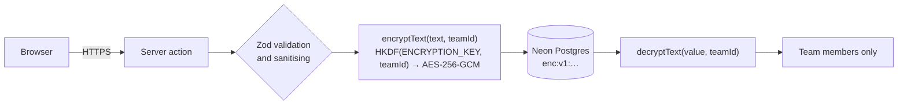
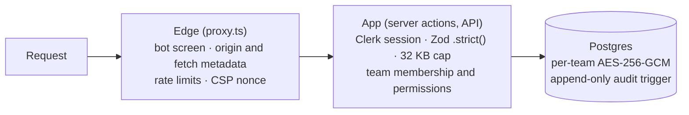

<div align="center">

<picture>
  <source media="(prefers-color-scheme: dark)" srcset=".github/assets/banner-dark.svg">
  
</picture>

**A private idea vault and execution board for friends, classes and small squads.**<br>
Capture ideas, agree on the good ones, turn them into projects, and ship them together.

[**Use it free at blueprint.raqameen.com**](https://blueprint.raqameen.com) · [Self-host it](#self-hosting) · [Security](#security-and-privacy) · [License](#license)

[](https://nextjs.org)
[](https://react.dev)
[](https://www.typescriptlang.org)
[](https://clerk.com)
[](https://neon.tech)
[](https://prisma.io)
[](#field-encryption)
[](./LICENSE)

</div>

---

## Contents

- [Why Blueprint](#why-blueprint)
- [Features](#features)
- [Using Blueprint](#using-blueprint)
- [Roles and permissions](#roles-and-permissions)
- [Security and privacy](#security-and-privacy)
- [Tech stack](#tech-stack)
- [Self-hosting](#self-hosting)
- [Deploy to Vercel](#deploy-to-vercel)
- [Administration](#administration)
- [Installed phone app](#installed-phone-app)
- [Connect Claude](#connect-claude)
- [Project structure](#project-structure)
- [Contributing](#contributing)
- [Support](#support)
- [License](#license)

## Why Blueprint

Big project tools are built for org charts. A few friends with a side project need none of it: no sprints, no story points, no seat licences, no workflow editor. Every minute spent configuring a tool is a minute the idea goes cold.

A small team needs three things, and Blueprint is built around them:

1. **A place to put ideas the moment they land.** Type it, drop it, done.
2. **A way to agree which ones are worth doing.** Sparks are one-click co-signs, so the best ideas rise without a meeting.
3. **A quiet signal that someone is on it.** Press *Start working* and your name lights up for the whole team.

When something ships, it stays on the record with your `@username` on it.

## Features

### Ideas and projects

- **Idea vault.** One shared list per team. Capture an idea in one line, spark the ones you like, and sort by most sparked or newest.
- **Custom tags.** Every team starts with `#feature`, `#bug`, `#experiment` and `#random`; the owner, co-owners and roles allowed to can add, rename, recolour (any colour, from presets or the full colour spectrum) and delete tags. Tags go on **tasks** (ideas and projects stay untagged). Renaming or deleting a tag updates every task that uses it.
- **Idea pages.** Open any raw idea to edit it and plan it with tasks and subtasks while it's still in the vault.
- **Promote to a project.** One click moves an idea, with any tasks it already has, into Execution and opens its project page. Or start a project from scratch.
- **Project pages.** Each project has its own page: description, progress, who is on it and what they're working on, and a board with only its tasks. **Project settings** on the page hold its name and description, plus *Back to ideas*, *Archive* and *Delete*.
- **Back to ideas.** Send a project in Execution back to the idea vault as if it had just been captured. Its tasks stay, but progress is reset: every task returns to Backlog, subtasks are unticked and live focus stops. The warning offers **Archive instead** for keeping everything as it is.
- **Archive and restore.** Archive ideas or projects to tidy up, with all their progress, and bring them back any time from team settings.

### Getting work done

- **Execution board.** Kanban (`Backlog → Ready → In progress → Done`) or a compact list, filtered to *My tasks*, *All tasks*, unassigned, or any teammate.
- **Drag and drop.** Drag a card to another column to move it: press and drag with a mouse, long-press and drag on a phone. A lifted copy follows your finger and the column under it lights up. People who can't move a task can't pick it up, and the ⋯ menu's *Move to* does the same from the keyboard.
- **View first, edit on purpose.** Tapping a task opens a read-only view of everything about it (details, tags, subtasks, who's on it). Editing lives behind **Edit** in that view or in the card's ⋯ menu, alongside *Move to* and *Delete*. A new task opens straight in the editor so you can add its details and subtasks.
- **Rich tasks.** Every task has a title, a description, notes, a priority, a project and the team's **tags**, plus a checklist of **subtasks**, each with its own description.
- **Connect Claude.** Let Claude work through your tasks: plan them into subtasks, write notes, move them along and capture ideas, as you, with exactly your permissions, only in the teams you pick and only where the owner allows it. See [Connect Claude](#connect-claude).
- **Import with AI.** Plan an idea with any AI assistant (ChatGPT, Claude, Gemini…): describe it in a few lines, copy Blueprint's ready-made prompt (it carries your description, the JSON format, the limits, your team's tags and planning guidance), paste the JSON the assistant writes, check the live preview, and add it to the **idea vault** with its tasks and subtasks in one go, ready to promote when the team agrees. Find it as **Import with AI** under the capture box and in the empty vault. Needs *Add ideas* and *Create tasks*. Blueprint never sends anything to an AI itself. Up to 40 tasks and 20 subtasks per task per import; tags the team doesn't have, and any tags on the idea itself, are left off.
- **Several people per task.** Assign one person or many to a task, and give each subtask its own people.
- **Private tasks.** When creating a task, choose **Everyone** or **Assignees only**. Private tasks are visible only to their assignees, their creator, the owner, co-owners and roles allowed to see them, and are never even sent to anyone else's browser.
- **Live focus.** *Start working* shows the team what you're on right now, with a running timer. Several people can be in focus on the same task.
- **Live everything.** Boards, tasks, subtasks, focus, ideas, sparks, tags, members, roles and the notification bell update on their own within a few seconds. See [Live updates](#live-updates).
- **Shipped.** A timeline of everything finished and who finished it, with weekly and all-time counts.

### Teams

- **Usernames and pictures.** Everyone picks a unique `@username` when they join, with a live availability check. Your Google or GitHub profile picture is used everywhere; initials only appear when you don't have one. Click your username in the header to copy it.
- **Unlimited teams.** Create as many as you like and invite people by `@username`, either while creating the team or any time after. Invites arrive live in a bell with one-click accept.
- **Team roles.** Owner, co-owners and plain members, plus **custom roles** you design permission by permission. See [Team roles](#team-roles).
- **Team settings.** Rename the team, manage members and roles, hand over ownership, manage projects and the archive, clear shipped tasks, leave, or delete the team.
- **Careful deletes.** Small deletes (a task, an idea) need a tick confirming there's no undo. Big ones (a project, a team, bulk clean-ups) need the exact name typed back. Deleting a project always deletes its tasks and subtasks with it; archive it instead to keep them.

### Account and home

- **Dashboard home.** After signing in you land on a home page with all your teams: search them, star favourites to keep them on top, see how many open tasks are yours in each, and accept invites.
- **Guided tours.** New accounts get a short welcome tour of the dashboard, then a walk through a **demo team** that exists only on their screen (capture, promote, plan, live focus, shipped, invites). Steps that would have nothing to point at show a clearly marked sample instead (an invite, an idea) and remove it afterwards; nothing is saved. Each step spotlights the real control and adapts to the layout: a card beside it on desktop, a bottom card on phones, and the tab bar and Profile tab in the installed app. Finished tours are saved to the account, and **Take the tour** (account menu or Profile) replays them. Keyboard friendly: arrows to move, Esc to skip.

- **Account window.** Appearance (system, light or dark theme; system, which follows your device, is the default) and Usage live inside the standard account window alongside your profile and security settings.
- **Free and unlimited.** No caps on teams, ideas, projects or tasks. The Usage page shows what you've made.
- **Support and feedback.** A *Contact support* window in the dashboard, user menu and app Profile tab: **Report a bug** or **Request a feature** right there (both land in the admin panel's **Feedback** inbox), or email support. You pick which page it's about: the one you're on, one you visited just before (handy on phones, where support lives on the Profile tab), any other page you can open (your own teams and their settings, your profile, and the admin panel if you're staff), or none. Plus Privacy Policy and Terms pages.

### Phones and installing

- **Built for phones.** Every screen fits a phone without sideways scrolling, buttons are large enough to tap, fields never zoom the page when you type, and the page doesn't bounce past its edges.
- **Install as an app.** On phones the dashboard offers once to add Blueprint to the home screen (Android shows the real install button; iPhone shows the two taps in Safari). It's also under **Install app** in the profile menu. Installed, it opens full screen with its own icon. The offer and the menu item disappear on devices where it's already installed: always inside the app itself, and in the browser too on Android and desktop Chrome/Edge (iPhone Safari gives websites no way to tell).
- **A real app layout once installed.** Opened from the home screen on a phone, Blueprint swaps the website chrome for an app layout in the same theme and with the same features. You get a greeting with your photo, first name, the date and your invites; a floating tab bar with **Home · Ideas · Tasks · Profile**; and a team chip that opens a team switcher, starred teams first. Tasks shows Live focus above *Projects · Mine · All · Shipped*, and ⚙ opens team settings. Profile is a settings list: Account, Appearance, Usage, support, Ko-fi, Privacy and Terms, Admin for staff, and Sign out. Pop-ups become bottom sheets you can swipe down to close. Tablets, desktop and phone browsers keep the website. Signed out, the app goes straight to sign-in. See [Installed phone app](#installed-phone-app).
- **Offline screen.** A tiny service worker shows a friendly "You're offline" screen instead of a browser error. It caches only the logo, never pages or team data.

### Platform

- **Site staff roles.** Support, Moderator and Admin roles with an admin panel for accounts, teams and the audit log. See [Administration](#administration).
- **Encrypted content.** Idea and task text is encrypted with a key unique to each team before it's stored. See [Field encryption](#field-encryption).
- **Interactive landing page.** The hero and the product tour are working replicas of the app, built in React and Framer Motion. No screenshots.

## Using Blueprint

1. **Sign up** with Google or GitHub, then choose your `@username` and colour.
2. **Create a team** and invite people with **Invite teammates**, searching by `@username`.
3. **Capture ideas** in the **Idea vault**, and spark the ones you believe in. Open an idea to plan it with tasks before committing to it.
4. **Promote** a good idea with one click. It moves to Execution and opens its project page, ready for tasks. Or start a project from **Execution → New project**.
5. **Plan the work.** Add tasks with the quick-add bar: pick who's on it and whether everyone or only assignees can see it. Open a task to write its description and notes and break it into subtasks.
6. **Work the board.** Assignees press **Start working** so the team knows, tick subtasks as they go, and press **Mark done** when it ships.
7. **Look back** in **Shipped** to see everything the team finished and who finished it.
8. **Set up roles and tags** in **Settings**: create custom roles and give them to members, and shape the team's tags.

## Roles and permissions

Blueprint has two kinds of role. **Team roles** apply inside one team. **Site roles** apply to the whole Blueprint instance, for running and moderating it.

### Team roles

| Role | What they can do |
| --- | --- |
| **Owner** | Everything, including deleting the team and its projects, choosing co-owners and transferring ownership. One per team. |
| **Co-owner** | Everything except deleting the team or projects, and choosing co-owners. Creates and manages custom roles. |
| **Member** (default) | Capture and spark ideas, manage their own ideas, and work on and finish tasks and subtasks assigned to them. They can't create or edit tasks. |
| **Custom role** | Exactly the permissions the owner or a co-owner picks for it (replaces the member defaults). |

Permissions a custom role can grant:

| Group | Permission | Allows |
| --- | --- | --- |
| Ideas | Capture ideas | Add ideas to the vault |
| | Manage all ideas | Edit, archive and delete anyone's ideas |
| | Manage tags | Add, rename, recolour and delete the team's tags |
| Projects | Create projects | Start projects and promote ideas |
| | Edit projects | Change any project's name and description |
| | Archive projects | Archive and restore projects, and move them back to ideas |
| Tasks | Create tasks | Add tasks and subtasks, choose assignees and visibility, and edit tasks they created |
| | Edit any task | Change details, assignees, priority, visibility and subtasks |
| | Move any task | Start, move and finish tasks they aren't assigned to |
| | Delete tasks | Permanently delete tasks |
| | See private tasks | See tasks that are visible to assignees only |
| People | Invite people | Invite people by username |
| | Manage members | Remove members and give them roles, but only roles with permissions they have themselves |
| Team | Edit team details | Change the team name and description |
| | Clean up | Clear shipped tasks and empty the archive |

Deleting projects and the team always stays with the owner. Every rule is enforced on the server in each action (`lib/team-permissions.ts`, `lib/team-access.ts`); the interface only hides what you can't use.

### Site roles

| Role | Can do |
| --- | --- |
| `USER` | Everyone. No admin access. |
| `SUPPORT` | Admin panel: look up accounts, teams and the audit log (read-only), and read, resolve and reject feedback. |
| `MODERATOR` | Support, plus suspend and unsuspend accounts, sign them out everywhere, and delete rejected feedback. |
| `ADMIN` | Everything: change site roles and usernames, delete accounts, delete teams. |

Staff can only act on accounts ranked below them (admins can act on anyone), never on themselves, and the last admin can't be removed. **No site role can read the text of ideas, projects or tasks.** The admin panel shows accounts, memberships and counts only.

## Security and privacy

### Field encryption

Idea and task text is encrypted in the application before it's written to Postgres, so it never sits in the database, its backups or Prisma Studio as plain text.

| Encrypted (AES-256-GCM) | Stays plain, so Postgres can index, sort and filter |
| --- | --- |
| Idea and project titles and descriptions | Tags, sparks, statuses, priorities, visibility |
| Task titles, descriptions and notes; subtask titles and descriptions | Team, author and assignee ids, roles, timestamps |

- **One key per team.** Each team's key is derived with HKDF-SHA256 from the master `ENCRYPTION_KEY` and the team id. A key for one team can't decrypt another team's rows.
- **Fresh IV on every write.** Values are stored as `enc:v1:<iv>:<authTag>:<ciphertext>` with a random 12-byte IV, so identical text never looks the same twice. The GCM auth tag rejects any altered or moved ciphertext.
- **Validate first, then encrypt.** Zod validation, sanitising and tag parsing run on the plaintext inside each server action, before encryption.
- **Fails closed in production.** The app refuses to start, and Vercel builds fail, without a valid `ENCRYPTION_KEY`. In local development it falls back to plaintext with a warning.
- **Bug reports too.** Reports sent from the Contact support window are encrypted with a separate key derived for bug reports only, so the admin panel can read them without being able to open any team's content.
- **Backwards compatible.** Rows written before encryption are read as-is. Run `npm run db:encrypt -- --apply` to encrypt them in place.



> [!IMPORTANT]
> Back up `ENCRYPTION_KEY` somewhere safe and never change it once data exists. If it's lost or changed, encrypted text can't be read again.

### Security architecture

Blueprint is built in layers, so no single check is the only thing standing between an attacker and your data. Each request passes the edge, then the app, then the database's own rules.



#### Layer 1: edge and anti-bot (`proxy.ts`, `lib/request.ts`, `lib/rate-limit.ts`)

| Defence | What it does |
| --- | --- |
| **Bot screening** | On the app's private routes (`/dashboard`, `/onboarding`, `/admin`, `/api`, `/sign-in`, `/sign-up`) and on every mutation, requests from HTTP libraries, scanners and headless browsers are refused with `403` (`curl`, `python-requests`, `Go-http-client`, `HeadlessChrome`, Puppeteer, Playwright, `sqlmap` and so on), as are requests with no `User-Agent`. Mutations must also carry a real browser `Accept-Language`. The public pages stay open to search engines and link previews. |
| **Request-forgery (CSRF) protection** | Every non-GET request, server actions included, must have an `Origin` that matches the site (or `ALLOWED_ORIGINS`), browser fetch metadata (`Sec-Fetch-Site`) of `same-origin` when present, and a `Referer` from the same origin when present. Checked at the edge and again inside every action. |
| **Rate limits** | In-memory sliding windows per IP and per user, with no external store and no extra cost. On serverless hosting each running instance counts on its own, so limits are approximate across instances; nothing else on this list depends on them. Every `429` carries `Retry-After`, `X-RateLimit-Limit`, `X-RateLimit-Remaining` and `X-RateLimit-Reset`. |
| **Trusted client IP** | Read in the order `x-vercel-forwarded-for` → `x-real-ip` → first `x-forwarded-for`, and each candidate must look like an IP address. On Vercel the first header is set by Vercel and can't be spoofed. |

| Rate-limit tier | Limit (per minute) | Applies to |
| --- | --- | --- |
| Global | 120 per IP | Every page and read |
| Username checks | 25 per IP and per user | Live "is this username free?" checks, so names can't be harvested |
| Invites and search | 15 per user, 30 per IP | Team invites and `@username` search |
| Mutations | 30 per user, 60 per IP | Ideas, tasks, subtasks, focus, teams, tags, roles |
| Onboarding | 5 per IP and per user | Claiming a username, refreshing your profile picture |
| Bug reports | 5 an hour per user, 10 per IP | Sending a report from the Contact support window |
| Live change-check | 90 per IP and per user | `/api/pulse` |

The per-IP ceiling is higher than the per-user one where people often share a network (an office, a classroom), so teammates don't use up each other's allowance. Sign-in and sign-up themselves are submitted to Clerk, which applies its own rate limits; turn on Clerk's **bot sign-up protection** in the Clerk dashboard as well.

#### Layer 2: HTTP headers and Content Security Policy (`proxy.ts`, `next.config.ts`)

- **Per-request nonce CSP.** A fresh random nonce on every response, with `script-src 'self' 'nonce-…' 'strict-dynamic'`. Browsers that understand nonces ignore the `https:` and `'unsafe-inline'` fallbacks, so injected inline scripts don't run.
- **The rest of the policy:** `default-src 'self'`, `object-src 'none'`, `base-uri 'self'`, `form-action 'self'`, `frame-ancestors 'none'`, `font-src 'self' data:`, `img-src 'self' data: https://img.clerk.com https://images.clerk.dev`, `frame-src` limited to Clerk's bot check and the Ko-fi widget, and `connect-src` limited to the site itself and Clerk. Postgres is only ever reached from the server, so the policy deliberately gives the browser no route to it.
- **Headers on every response:** `Strict-Transport-Security: max-age=63072000; includeSubDomains; preload`, `X-Frame-Options: DENY`, `X-Content-Type-Options: nosniff`, `Referrer-Policy: strict-origin-when-cross-origin`, `Permissions-Policy: camera=(), microphone=(), geolocation=(), browsing-topics=()`, `Cross-Origin-Opener-Policy`, `Cross-Origin-Resource-Policy: same-origin`, and no `X-Powered-By`.

#### Layer 3: application and server actions (`lib/action.ts`, `lib/team-access.ts`, `lib/validations.ts`, `app/actions/*`)

| Defence | What it does |
| --- | --- |
| **One guarded path for every mutation** | Every server action runs through `runAction()`: origin check, Clerk session resolved on the server, suspension check, rate limit, onboarding check, then the handler. |
| **Zero-trust team isolation (anti-IDOR)** | Team, task and idea ids from the browser are never trusted. Every team action re-reads the caller's membership and permissions from Postgres (`requireTeamAccess`), and every read, update and delete is scoped to `{ id, teamId: verifiedTeamId }`. Assignees must belong to that exact team. Team pages load your membership alongside the session and answer `404` to anyone outside the team. |
| **Team roles and private tasks** | Owner, co-owner, member and custom-role permissions are checked on every action. Private tasks are filtered inside the database query, so they never reach people who can't see them. |
| **Strict schemas** | Zod `.strict()` schemas reject unexpected fields on every payload. Server action bodies are capped at 32 KB. |
| **Sanitising** | Control characters, zero-width and bidirectional-override characters (Trojan Source) and HTML tags are stripped before anything reaches the app logic. Queries are parameterised only. |
| **Input limits** | Usernames `^[a-z0-9_]{3,20}$` with a reserved list (`admin`, `api`, `auth`, `app`, `system`, `root`, `null`, `undefined` and more). Titles up to 120 characters, idea bodies 500, descriptions 1,000, task notes 2,000, team names 40, at most 5 tags per task. The same limits (`LIMITS` in `lib/constants.ts`) drive the form fields. |
| **Typed confirmations** | Destructive actions check the typed team, project or username on the server, not only in the browser. |
| **Safe errors** | Unexpected errors are logged on the server with a short reference code, with connection strings and secrets scrubbed from the log line. People only ever see "An unexpected error occurred. Please try again." plus that code, never a stack trace, Prisma code or file path. |
| **Profile pictures from Clerk only** | Pictures are read from Clerk on the server, never taken from the browser. |
| **Metadata-only admin panel** | The admin panel shows counts, account and team metadata, the audit trail and bug reports. It never selects, decrypts or renders idea or task text, and a lint rule stops admin code from importing `lib/crypto.ts`. Bug reports are opened through `lib/bug-reports.ts`, which can only use the bug-report key. Staff permissions are re-read on every admin action, and non-staff get a `404`. |

#### Layer 4: live focus and the audit trail (`app/actions/tasks.ts`, `lib/audit.ts`)

- **Focus can't be faked.** You can only focus on a task in a team you belong to, that you're assigned to (or allowed to edit). One focus per person across the whole site: starting one ends any other, in every team. The start time is the server's clock, and everyone's timer counts from that stored time, never from a time the browser sends.
- **Audit trail and team activity.** Every change to ideas, projects, tasks and subtasks (created, edited, moved, assigned, ticked, deleted), plus team creation, invites, membership removals and departures, role and custom-role changes, staff actions, Claude connections and changes (marked `via claude`) and rate-limit hits are recorded with a fixed list of action names (`AuditAction`), the actor's id and `@username`, the time, and a **shortened IP** (IPv4 `/24`, IPv6 `/48`: the network, not the person). Entries never contain idea or task content: only ids, the task and project they belong to, and non-content details (the column a task moved to, which fields changed). Members see their team's activity in **Team settings → Activity**, a project's in **Project settings** and a task's under **History**, with an *Everything / By Claude* filter, never IPs, and never entries about private tasks they can't see.
- **Append-only, twice over.** The Prisma client refuses every update and delete on the audit table, and a Postgres trigger refuses `UPDATE`, `DELETE` and `TRUNCATE` even from raw SQL or scripts.
- **No denial-of-wallet through logging.** Rate-limit hits by signed-in people are written at most once a minute per person and tier. Anonymous floods stopped at the edge are only written to the server log with a shortened IP, so an attack spread over many addresses can't turn into a flood of database writes.

Found a vulnerability? Please see [`SECURITY.md`](./SECURITY.md) and email **support@raqameen.com** instead of opening a public issue.

### Live updates

Blueprint stays live without WebSockets or a third-party realtime service:

1. Every change stamps `activityAt` on the team (or `inboxAt` on the person it notifies).
2. While a tab is visible it asks `GET /api/pulse` every 4 seconds for those two timestamps. That is one indexed query and well under a kilobyte.
3. Only when a timestamp moves does the tab re-fetch the page data. Your own actions update instantly. On the dashboard home it watches the latest change across all your teams.

Hidden tabs stop polling and check again the moment they're shown, and the endpoint has its own per-user rate limit so a few open tabs never crowd out the rest of the app.

## Tech stack

| | |
| --- | --- |
| **Framework** | Next.js 16 (App Router, server actions, Turbopack), React 19, TypeScript 5 |
| **Auth** | Clerk (Google and GitHub sign-in), lazy user sync with no webhooks |
| **Database** | Neon serverless Postgres with Prisma 6 in driver-adapter mode (`engineType = "client"`, no native engine) |
| **UI** | Tailwind CSS 4, Framer Motion, light and dark themes |
| **Validation** | Zod 4 |
| **Crypto** | Node `crypto`: AES-256-GCM with HKDF-SHA256 key derivation, no extra dependencies |
| **Hosting** | Vercel (`iad1`, next to Neon `us-east-1`) |

## Self-hosting

Self-hosting is free for any noncommercial use. It takes a few minutes and free tiers of Clerk, Neon and Vercel are enough.

### Requirements

- Node.js 24
- A [Clerk](https://clerk.com) application (free)
- A [Neon](https://neon.tech) Postgres database (free)

### Quick start

```bash
git clone https://github.com/Uoerim/blueprint.git
cd blueprint
npm install
```

**1. Connect Clerk.** This links a Clerk application and writes its keys to `.env.local`:

```bash
npx -y clerk@latest init
```

**2. Add the database and encryption key.** Copy the rest of `.env.example` into `.env.local` and fill in:

```bash
POSTGRES_PRISMA_URL=...        # Neon pooled URL (host contains -pooler)
POSTGRES_URL_NON_POOLING=...   # Neon direct URL
ENCRYPTION_KEY=...             # see below
```

Generate the encryption key with:

```bash
node -e "console.log(require('crypto').randomBytes(32).toString('hex'))"
```

**3. Create the tables.** Optionally seed two demo teams to explore:

```bash
npm run db:deploy
npm run db:seed      # optional; set SEED_INVITE_USERNAME=your_username to get invites to the demo teams
```

**4. Run it.**

```bash
npm run dev
```

Open http://localhost:3000, sign up, choose your `@username`, and create a team.

**5. Make yourself an admin** (optional):

```bash
npm run site:role -- your_username ADMIN
```

### Environment variables

| Variable | Required | Purpose |
| --- | :---: | --- |
| `NEXT_PUBLIC_CLERK_PUBLISHABLE_KEY`, `CLERK_SECRET_KEY` | ✅ | Clerk keys (`pk_…`, `sk_…`). The secret key is server-only. |
| `NEXT_PUBLIC_CLERK_SIGN_IN_URL`, `NEXT_PUBLIC_CLERK_SIGN_UP_URL` | ✅ | `/sign-in` and `/sign-up` |
| `NEXT_PUBLIC_CLERK_SIGN_IN_FALLBACK_REDIRECT_URL`, `…SIGN_UP_FALLBACK_REDIRECT_URL` | ✅ | `/dashboard` and `/onboarding` |
| `POSTGRES_PRISMA_URL` | ✅ | Neon pooled connection string (`DATABASE_URL` also works) |
| `POSTGRES_URL_NON_POOLING` | ✅ | Neon direct connection string, used for migrations (`DATABASE_URL_UNPOOLED` also works) |
| `ENCRYPTION_KEY` | ✅ in production | 32 bytes as 64 hex characters. Encrypts idea and task text. |
| `ALLOWED_ORIGINS` | Recommended | Comma-separated origins allowed to send mutations, e.g. `https://blueprint.raqameen.com`. Without it the origin must match the host the request reached. |
| `SEED_INVITE_USERNAME` | | Your username, to receive invites to the seeded demo teams |

### Scripts

| Command | What it does |
| --- | --- |
| `npm run dev` | Development server |
| `npm run build` / `npm start` | Production build and server |
| `npm run typecheck` / `npm run lint` | TypeScript and ESLint |
| `npm run db:deploy` | Apply migrations from `prisma/migrations` |
| `npm run db:migrate -- --name <change>` | Create a new migration after editing the schema |
| `npm run db:seed` | Demo data (refuses to run against production) |
| `npm run db:studio` | Prisma Studio. Encrypted fields show as `enc:v1:…`. |
| `npm run db:encrypt [-- --apply]` | Encrypt rows written before `ENCRYPTION_KEY` was set. Dry run unless `--apply`. |
| `npm run site:role -- <username> <ROLE>` | Set a site role: `USER`, `SUPPORT`, `MODERATOR` or `ADMIN` |
| `npm run site:role -- list` / `unsuspend <username>` | List staff, or lift a suspension |
| `npm run team:role -- <username> <team-slug> <ROLE>` | Set a team role: `OWNER`, `CO_OWNER` or `MEMBER` |

## Deploy to Vercel

Vercel runs `scripts/vercel-build.mjs` automatically. It checks `ENCRYPTION_KEY`, runs `prisma generate`, applies pending migrations with `prisma migrate deploy`, then builds. It accepts Neon variables under any of their usual names and stops with a clear message if the database or key is missing.

### 1. Clerk production instance

1. In the [Clerk dashboard](https://dashboard.clerk.com), switch the app to **Production** and create the instance (clone the development settings).
2. Clerk production needs a **domain you own**. Add it, then create the DNS records Clerk lists and wait until they're verified.
3. Add your own OAuth credentials under **SSO connections**:
   - **GitHub:** Settings → Developer settings → OAuth Apps. Use your domain as the homepage and Clerk's redirect URI as the callback.
   - **Google:** Google Cloud Console → APIs & Services. Publish the consent screen (with your `/privacy` and `/terms` links), then create a Web OAuth client with Clerk's redirect URI.
4. Under **Legal**, add `https://your-domain/terms` and `https://your-domain/privacy`.
5. Copy the `pk_live_…` and `sk_live_…` keys.

### 2. Vercel project

1. **Add New → Project** and import the repository. Keep the default Next.js settings.
2. Under **Storage**, connect **Neon**. Its variables are added for you.
3. Under **Settings → Environment Variables**, add the Clerk variables, `ENCRYPTION_KEY` and `ALLOWED_ORIGINS` from the table above.
   - Save `CLERK_SECRET_KEY` and `ENCRYPTION_KEY` as **Sensitive**, so their values can never be read back in the dashboard (see [Secrets](#secrets)).
   - Scope the live Clerk keys and the production database to **Production**.
   - Give **Preview** your development Clerk keys, a separate Neon branch, and its own `ENCRYPTION_KEY`, so preview builds never touch production data.
4. Add your domain under **Domains** and point DNS at Vercel.
5. **Deploy.** `NEXT_PUBLIC_*` values are built in, so redeploy after changing them.

### Secrets

Vercel flags variables that look like secrets but are readable in the dashboard. To fix that for good:

- **`CLERK_SECRET_KEY`:** in Clerk, open **API keys** and create a new secret key. In Vercel, delete the old variable and add it again with the new value and **Sensitive** switched on. Redeploy, check sign-in works, then delete the old key in Clerk.
- **`ENCRYPTION_KEY`:** **never rotate it**: data encrypted with it can't be read with a new key. Re-add the *same* value as **Sensitive** instead (copy it from your password manager or backup first, because Sensitive values can't be read back).
- Variables from the Neon integration are managed by that integration.

### 3. After the first deploy

```bash
# with the production POSTGRES_* URLs exported in your shell
npm run site:role -- your_username ADMIN
npm run db:encrypt -- --apply   # only if the database already had data from before encryption
```

## Administration

Staff open the admin panel from the **Admin** button in the dashboard header, at `/admin`.

| Page | What it shows |
| --- | --- |
| **Overview** | Platform HUD: accounts, new this week, suspended, staff, teams, ideas, tasks, tasks shipped, people in focus right now and security events in the last 24 hours, plus newest accounts and recent staff actions |
| **Accounts** | Username, colour, email, site role, status, team count and join date; search by username, name or email; filter staff, suspended or deleted accounts |
| **Account** | Details, teams, activity, and actions: change username (admins), change site role, suspend with a reason, sign out everywhere, delete |
| **Teams** | Name, slug, owner, member/idea/task counts and created date; admins can delete a team |
| **Feedback** | Bug reports and feature requests sent from the Contact support window, newest first, filtered by type and status: who sent it, when, the page and a short device summary, and the text. Filter open, resolved, rejected or all; support staff and above can resolve, reject or reopen them, and moderators and above can delete rejected ones (one at a time, or all at once after typing a confirmation) |
| **Audit log** | A stream of `TEAM_CREATED`, `INVITE_SENT`, `TASK_DONE`, `SECURITY_RATE_LIMITED` and other events with time, actor, target and team slug. Views: staff actions, security, or everything. Admins also see the shortened IP addresses. |

- **Suspending** blocks the account everywhere, bans it in Clerk, ends its sessions, and shows the reason on a *suspended* page.
- **Renaming** (admins only, their own account included) follows the same rules as sign-up: 3 to 20 characters of a to z, 0 to 9 and _, no reserved names, not already taken. The old name becomes free to claim, teammates see the new one on their next live update, and the change is recorded as `ADMIN_USER_RENAMED`. Useful for reclaiming names that impersonate someone.
- **Deleting** removes the login, memberships, invites and Claude connections, and keeps only the account's former `@username` for the security record, so the accounts list and audit log show "@name (deleted)". Owned teams pass to the next admin or member, or are deleted when empty. Shared ideas and tasks stay, without the person's name.
- **The first admin** can only be created from the terminal with `npm run site:role`. The script shows which database it will change and asks you to type the username back. There is no web route or secret that grants a role.

## Installed phone app

The app layout applies when **both** are true:

- Blueprint was launched from the home screen (`display-mode: standalone`);
- and the screen is phone-sized (narrower than 768px).

Everything is built with one Tailwind variant, `app:`, defined in `app/globals.css`. The app pieces are rendered for everyone but only shown under `app:`, and website pieces they replace carry `app:hidden`. That means the website itself never changes.

**Previewing without installing.** On a phone browser (or a desktop browser narrowed to phone width), open `/dashboard?app=1`. A cookie keeps the preview on for that browser; `/dashboard?app=0` turns it off. The preview is cosmetic only and grants nothing.

**Notes**

- The Ideas and Tasks tabs open the team you were last in (remembered in a `bp-last-team` cookie, checked against your memberships on the server).
- Before you're in any team, Ideas and Tasks open a short screen that explains what lives there, with **Create a team**, your pending invites, or your @username to share so someone can invite you (`/dashboard/new`).
- The Profile tab lives at `/dashboard/me`, so `me`, `new`, `tour`, `connections`, `connect` and `admin` are reserved and can't be used as team slugs.
- Saving feels instant and calm: something you create appears at once under an id chosen in your browser, which the server keeps, so it never jumps or replays its entrance animation when the save lands. Your own saves don't trigger a second live refresh either.
- A real launch screen: on iPhone, iOS shows Blueprint's own launch image (one per screen size, light and dark, built at deploy time) instead of a blank page, and the app picks up from it with the same mark in the same place. It stays until the app can take taps, shows a slim progress line if starting takes a moment, then lifts away. Website visitors never see it.
- Faster launches: the service worker keeps Blueprint's own code, styles and fonts on the device (never pages or data), so the installed app starts without downloading them again.
- Every tab is ready before you tap it: a moment after launch the tab bar loads each tab's screen with its data, so the first switch is instant; a screen opened from that preload quietly refreshes itself if it's more than a few seconds old. Skipped when the phone asks to save data.
- Native-feeling motion: new screens ease in, and the tab bar's highlight glides to the tab you tap. Reduced-motion settings turn both off.
- Switching tabs is built to feel instant:
  - Ideas ↔ Tasks within the same team switch on the device without asking the server;
  - every other tab shows its loading screen the moment you tap;
  - screens you just left stay ready for 30 seconds (`staleTimes` in `next.config.ts`). Live updates re-check a screen as you return and refresh it if anything changed, and signing in or out clears them.
- Pages load your account and their data side by side (`withOnboardedPage` and `requireTeamPage` in `lib/auth.ts`), each query scoped to the verified session.
- After an update, fully close the installed app and reopen it to pick up the new layout.

## Connect Claude

Blueprint can be connected to **Claude** (on the web, desktop, phone or Claude Code) so it can work through your tasks for you: read them, plan them into subtasks, write descriptions and notes, move them along, tick subtasks off and capture ideas. It's built as a remote **MCP server** with Blueprint as its own **OAuth 2.1** authorization server, so people connect with their normal Blueprint sign-in and nothing needs to be pasted or shared.

### How people use it

1. A team's **owner** turns on *Claude* in the team's settings (off by default). Turning it off later cuts every connection off that team at once.
2. Anyone in the team opens **Connect Claude** (account menu, or the app's Profile tab), copies the address `https://<your-domain>/api/mcp` and adds it in Claude as a custom connector (*Settings → Connectors*), or runs `claude mcp add --transport http blueprint https://<your-domain>/api/mcp` in Claude Code.
3. Claude opens Blueprint's consent screen (`/connect`): they pick which of their teams Claude may use and what it may do (*Read* always; *Work on tasks* and *Add ideas and tasks* optional), then return to Claude.
4. The same page lists their connections, with last use and **Disconnect**.

### Tools

| Tool | Scope | What it does |
| --- | --- | --- |
| `list_teams` | read | Teams Claude may use (picked, still a member, owner allows it) and your role |
| `list_tasks` | read | Your open tasks by default, or every task you can see; filter by status or project |
| `get_task` | read | Description, notes, subtasks, assignees, and what you're allowed to change |
| `list_ideas`, `get_idea` | read | Raw ideas and projects, with the tasks in them you can see |
| `update_task` | tasks | Title, description, notes, priority, tags |
| `set_task_status` | tasks | Backlog, ready, in progress, done |
| `add_subtasks`, `set_subtask_done` | tasks | Add checklist items, tick them |
| `create_task`, `capture_idea` | create | New tasks (assigned to you by default) and ideas |

There are **no** delete, member, role, invite, archive or settings tools.

### Security model

- **Never more than the person.** Every tool runs the app's own operations (`lib/ops/*`, shared with the server actions), so membership, role, custom-role permissions, private-task visibility and every task rule are checked fresh on each call, exactly as for clicks in the app. A promotion or demotion applies to Claude instantly.
- **Three locks per team.** A team is reachable only if the person picked it on the consent screen, is still a member, and the owner's switch is on. All three are re-checked on every call; a team you leave or that is switched off disappears immediately.
- **Scopes.** Tools are listed and allowed only for the scopes granted. *Read* is always included; writing needs *tasks*, creating needs *create*.
- **OAuth 2.1, by the book.** Public clients with **PKCE S256 required**; authorization codes last 60 seconds and work once; access tokens last 1 hour; refresh tokens last 30 days and are **rotated on every use**, and reusing a spent one is treated as theft and ends the whole connection (logged as `SECURITY_AGENT_TOKEN_REUSE`). Resource indicators (RFC 8707) bind tokens to `/api/mcp`, and the issuer is returned with the code (RFC 9207). Discovery follows RFC 9728 and RFC 8414 (`/.well-known/oauth-protected-resource`, `/.well-known/oauth-authorization-server`).
- **Only Claude can register.** Dynamic client registration (RFC 7591) accepts only Claude's own callback (`https://claude.ai/api/mcp/auth_callback`, `https://claude.com/…`) or a loopback address for Claude Code / Claude Desktop (RFC 8252, any port). Anything else is refused, so no other website can start the flow. Unused registrations are cleared after a day.
- **Nothing secret is stored.** Codes and tokens are random 256-bit values with readable prefixes (`bpac_`, `bpat_`, `bprt_`); only their SHA-256 hashes are kept. PKCE checks use constant-time comparison. Token responses are `no-store`.
- **Consent is checked twice.** The consent page validates the request, and the approve action validates it all again server-side (app, return address, PKCE, scopes, every team), behind the same origin check and rate limits as every server action. A wrong app or return address never gets a redirect.
- **Endpoint hardening.** Stateless Streamable HTTP with JSON responses; browser requests from other origins are refused (MCP's DNS-rebinding guidance); 256 KB request cap; protocol version checked; 120 requests a minute and 30 changes a minute per connection, with generous per-IP ceilings because Claude's servers share addresses. These routes skip bot screening and the cookie-CSRF check because they take bearer tokens only.
- **On the record, permanently.** Every change made through Claude is logged in the team's activity marked `via claude` (and shown as *via Claude* in the admin audit log). Ideas, tasks and subtasks Claude makes carry a **Made by Claude** mark that a database trigger makes impossible to change or remove, even with raw SQL; once Claude has worked on a task, **Claude worked on this** can never be cleared either; and **Finished by Claude** / **Ticked by Claude** show what it completed (cleared only if someone reopens it). Connecting and disconnecting are logged too. Suspended or deleted accounts lose access at once, and deleting an account deletes its connections.
- **Prompt-injection aware.** Claude is told that text inside ideas and tasks is data written by team members, not instructions, and there are no destructive tools for injected text to reach.
- **Privacy.** Content Claude reads leaves Blueprint's encryption and goes to Anthropic under its terms. That's spelled out on the consent screen, in team settings, in the Privacy Policy and the Terms, and it only ever happens after both the owner and the person opt in.

### Self-hosting it

Nothing to configure: the endpoints use whatever domain the request arrives on. Make sure the site is served over HTTPS (Claude requires it) and run the migrations. The end-to-end checks (registration, PKCE, rotation and theft detection, scopes, team switch, visibility, promotions and demotions, suspension, revocation) are easy to repeat against a test schema.

## Project structure

```text
app/
  page.tsx                 landing page and product tour
  actions/                 server actions: ideas, tasks, tags, teams, admin, account, support
  api/pulse/               the live change-check
  api/mcp/                 Connect Claude: the MCP endpoint
  api/oauth/               Connect Claude: app registration, tokens, revocation
  .well-known/             OAuth discovery documents (RFC 9728, RFC 8414)
  connect/                 Connect Claude consent screen (the authorization endpoint)
  dashboard/connections/   Connect Claude: setup, your connections, Disconnect
  manifest.ts sw (public/) install-as-app manifest and offline service worker
  admin/                   staff panel: overview, accounts, teams, bug reports, audit log
  dashboard/[teamSlug]/    workspace: vault, execution, project pages, shipped, settings
  dashboard/me/            the installed app's Profile tab
  dashboard/tour/          the demo team the welcome tour opens (on screen only)
  dashboard/_components/   app-shell.tsx (app header, tab bar, preview switch), app-team-bar.tsx
  onboarding/ suspended/   username setup, suspended-account page
  privacy/ terms/          legal pages
components/
  landing/                 interactive landing demos
  tour/                    guided tours: spotlight engine, launcher, replay
  ui/                      dialogs, confirm dialog, popovers, toasts, primitives
lib/
  oauth.ts oauth-tokens.ts Connect Claude: scopes, PKCE, return-address rules, token issue and checks
  mcp/                     the MCP server (JSON-RPC) and its permission-checked tools
  ops/                     task and idea operations shared by server actions and Claude
  activity-log.ts          team, project and task activity read from the audit trail (visibility-filtered)
  live.ts                  ids chosen in the browser (no remount after saving), smarter live refresh
  recent-pages.ts          the last pages visited in this tab, so feedback can say which one it's about
  splash.ts                iPhone launch screens: the screen sizes and the startup-image links
  import-template.ts       the "Import from JSON" format, AI prompt and reply parsing
  tour-demo.ts             on-screen-only samples shown by the guided tours
  crypto.ts                per-team AES-256-GCM field encryption
  activity.ts              change stamps for live updates (see /api/pulse)
  auth.ts site-roles.ts    sessions, suspensions, site staff permissions
  team-permissions.ts      team roles, custom role permissions, task rules
  team-access.ts           per-action team membership and permission checks
  action.ts api.ts         server action and API guards (origin, rate limit, auth)
  request.ts               client IP, origin checks, bot screening
  rate-limit.ts            in-memory sliding-window rate limits
  audit.ts                 append-only audit trail and its action list
  bug-reports.ts           bug report encryption (its own key) and device summaries
  errors.ts                safe error messages and scrubbed server logs
  validations.ts           Zod schemas and sanitising
  app-mode.ts              detects the installed phone app (or the ?app=1 preview)
prisma/
  schema.prisma migrations/   (folders sort by their "_"-separated parts, so new ones continue 9b_, 9c_, …)
  seed.ts                  demo data
  site-role.ts set-role.ts site-role and team-role CLIs
  encrypt-existing.ts      encrypts rows written before ENCRYPTION_KEY was set
proxy.ts                   CSP, bot screening, origin checks, rate limiting, route protection
instrumentation.ts         refuses to start without ENCRYPTION_KEY in production
```

## Contributing

Issues and pull requests are welcome.

1. Fork the repository and create a branch.
2. Follow [Self-hosting](#self-hosting) to run it locally.
3. Keep `npm run typecheck` and `npm run lint` passing, and try UI changes in the browser.
4. Open a pull request. The template asks what changed and how you tested it.

By submitting a pull request you agree to the Inbound Contributor License Grant at the end of [`LICENSE`](./LICENSE). Please report security problems privately, as described in [`SECURITY.md`](./SECURITY.md).

## Support

- **Help, account or data requests:** support@raqameen.com, or **Contact support** in the app
- **Bugs and ideas:** [GitHub issues](https://github.com/Uoerim/blueprint/issues)
- **Like it?** [Support Blueprint on Ko-fi](https://ko-fi.com/yosifibrahim)

## License

**Blueprint is free for non-commercial use**, under the [PolyForm Noncommercial License 1.0.0](./LICENSE).

Blueprint is **source-available**: every line of code is public and free to use, change and self-host for non-commercial purposes. It isn't "open source" in the strict OSI sense, because commercial use is reserved for the author.

- ✅ Clone, modify, and self-host on your own database/Vercel for free with your friends, classes, or squad.
- ✅ Share your changes under the same non-commercial license, with credit (keep the `LICENSE` file and its `Required Notice` line).
- 💡 **Official hosted version ([blueprint.raqameen.com](https://blueprint.raqameen.com)):** Only the official hosted app may offer paid options or lightweight ads, to support domain, database, and hosting costs. Want it completely free? Self-host it in a few minutes with the [Quick start](#quick-start) above.
- ❌ Third parties may not sell Blueprint, run ads on it, offer it as a paid hosted SaaS, or use it commercially without written permission.
- ™️ The license covers the code, not the Blueprint name or logo. A modified or self-hosted copy mustn't present itself as the official Blueprint service.
- 🤝 **Contributions:** By submitting a PR, you grant the author the right to use your contribution in both the open repository and the official hosted instance. See the Inbound Contributor License Grant at the end of [`LICENSE`](./LICENSE).

For commercial permission, open an issue or email support@raqameen.com.

<div align="center">
<br>
<br>
<sub>© 2026 Yosuf Mohamed Ali Ibrahim (Raqameen)</sub>
</div>
